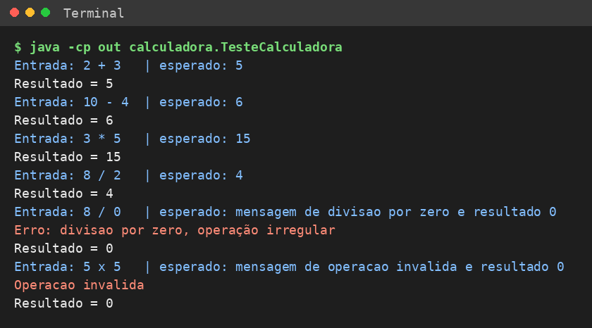
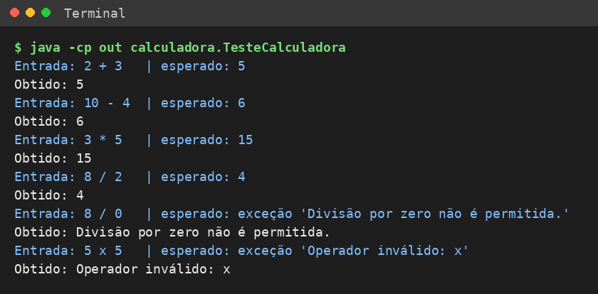
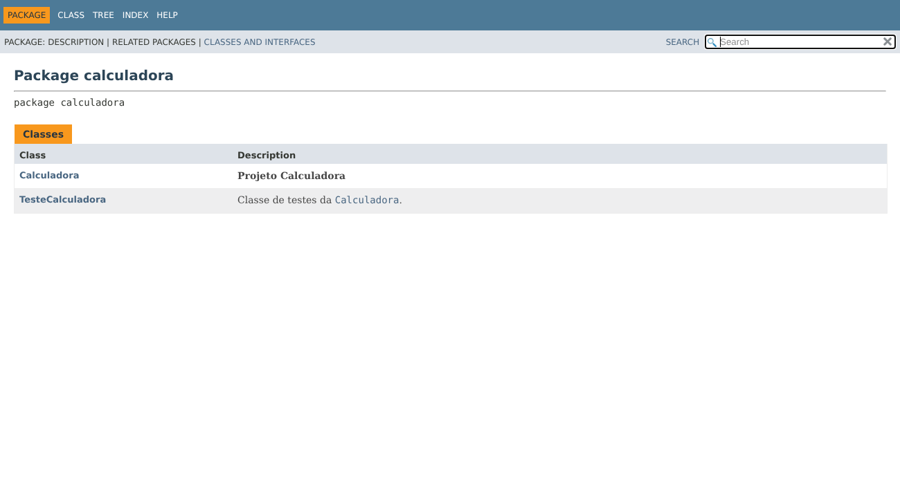
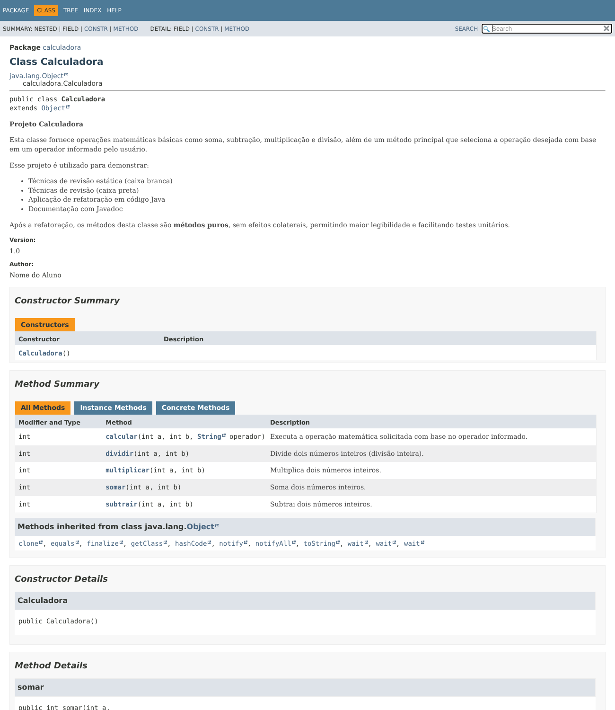

# Projeto Calculadora — FinançApp

> Projeto acadêmico desenvolvido com foco em Qualidade de Software, Testes, Refatoração, Documentação e Versionamento.

---

## 1. Identificação do Projeto

**Projeto:** Projeto Calculadora  
**Contexto:** FinançApp  
**Aluno:** Nome do aluno *(preencher)*  
**RA:** XXXXXXX *(preencher)*  
**Curso:** Nome do curso *(preencher)*  
**Disciplina:** UX/UI e Testes de Software (AS406TSN1)  
**Professor:** Daniel Ohata  
**Semestre:** 2026.2  

---

# 2. Visão Geral

O projeto consiste no desenvolvimento de um módulo de cálculos matemáticos básicos em Java para a startup fictícia **FinançApp**.

O módulo foi desenvolvido com o objetivo de ser utilizado futuramente em funcionalidades de controle financeiro, como:

- orçamento mensal;
- divisão de despesas;
- projeções financeiras;
- cálculos auxiliares.

Além do funcionamento correto das operações, o projeto aplica práticas de qualidade de software relacionadas a:

- testes;
- tratamento de erros;
- refatoração;
- documentação;
- versionamento;
- manutenção de código.

---

# 3. Problema

Durante o desenvolvimento da aplicação FinançApp, foi identificada a necessidade de criar um módulo matemático reutilizável.

Entretanto, a equipe definiu que o módulo não deveria apenas funcionar corretamente, mas também apresentar:

- código legível;
- testes automatizados;
- tratamento de falhas;
- documentação técnica;
- controle de versões;
- facilidade de manutenção.

O desafio consiste, portanto, em desenvolver uma solução funcional e ao mesmo tempo aplicar boas práticas de Engenharia de Software.

---

# 4. Objetivo

## 4.1 Objetivo Geral

Desenvolver uma calculadora em Java aplicando práticas de qualidade, testes, documentação, refatoração e versionamento.

## 4.2 Objetivos Técnicos

- implementar operações matemáticas básicas;
- tratar entradas inválidas;
- impedir divisão por zero;
- desenvolver testes automatizados;
- refatorar o código sem alterar seu comportamento;
- documentar classes e métodos com JavaDoc;
- gerar documentação HTML;
- utilizar Git e GitHub;
- organizar commits e branches;
- manter documentação técnica no README.

---

# 5. Escopo Funcional

A aplicação deverá oferecer as seguintes operações:

| ID | Funcionalidade | Descrição | Status |
|---|---|---|---|
| RF01 | Soma | Soma dois números inteiros | ✅ |
| RF02 | Subtração | Subtrai dois números inteiros | ✅ |
| RF03 | Multiplicação | Multiplica dois números inteiros | ✅ |
| RF04 | Divisão | Divide dois números inteiros | ✅ |
| RF05 | Validação de divisão | Impede divisão por zero | ✅ |
| RF06 | Operação inválida | Trata operadores não suportados | ✅ |

---

# 6. Requisitos Não Funcionais

| ID | Categoria | Requisito |
|---|---|---|
| RNF01 | Qualidade | O código deve possuir organização e legibilidade |
| RNF02 | Testabilidade | As operações devem possuir testes automatizados |
| RNF03 | Manutenção | O código deve permitir refatoração sem alteração funcional |
| RNF04 | Documentação | Classes e métodos devem possuir JavaDoc |
| RNF05 | Versionamento | O projeto deve utilizar Git e GitHub |
| RNF06 | Confiabilidade | Erros não devem interromper inesperadamente a execução |

---

# 7. Tecnologias Utilizadas

| Tecnologia | Versão | Utilização |
|---|---|---|
| Java | 21 | Desenvolvimento |
| JDK | OpenJDK 21 | Compilação |
| JUnit | — (não utilizado) | Os testes são feitos na classe `TesteCalculadora`, executada via `main`, conforme os slides da aula |
| Git | 2.43 | Controle de versão |
| GitHub | — | Repositório remoto |
| JavaDoc | JDK 21 | Documentação |
| IDE | Terminal (`javac`/`java`); compatível com VS Code e Eclipse | Ambiente de desenvolvimento |

---

# 8. Estrutura do Projeto

```text
projeto_calculadora/
│
├── src/
│   └── calculadora/
│       └── Calculadora.java
│
├── test/
│   └── calculadora/
│       └── TesteCalculadora.java
│
├── docs/
│   └── index.html
│
├── images/
│   ├── testes/
│   ├── javadoc/
│   └── refatoracao/
│
├── README.md
├── .gitignore
├── gerar_docs.sh
└── demais arquivos do projeto
```

---

# 9. Explicação das Operações

## 9.1 Versão original (branch `main`)

A classe `Calculadora` possui o atributo público `r` (resultado) e o método principal `int calc(int a, int b, String op)`, que decide a operação por uma cadeia de `if / else if`, imprime `Resultado = ...` e retorna o valor.

| Operador | Operação | Comportamento |
|---|---|---|
| `+` | Soma | `r = a + b` |
| `-` | Subtração | `r = a - b` |
| `*` | Multiplicação | `r = a * b` |
| `/` | Divisão | `r = a / b`; se `b == 0`, imprime a mensagem de erro e retorna `0` |
| outro | Operação inválida | imprime `Operacao invalida` e retorna `0` |

## 9.2 Versão refatorada (branch `Refatoracao`)

| Método | Descrição | Erro tratado |
|---|---|---|
| `somar(int a, int b)` | Retorna `a + b` | — |
| `subtrair(int a, int b)` | Retorna `a - b` | — |
| `multiplicar(int a, int b)` | Retorna `a * b` | — |
| `dividir(int a, int b)` | Retorna a divisão inteira `a / b` | `IllegalArgumentException("Divisão por zero não é permitida.")` quando `b == 0` |
| `calcular(int a, int b, String operador)` | Escolhe a operação com `switch` | `IllegalArgumentException("Operador inválido: ...")` para operadores não suportados |

Os métodos passaram a ser **puros** (sem `System.out` e sem estado interno), e os erros deixaram de ser mensagens soltas para virar exceções, que o chamador trata com `try/catch` sem interromper o programa.

---

# 10. Testes

A classe `TesteCalculadora` exibe, para cada caso, a **entrada utilizada**, o **resultado esperado** e o **resultado obtido**.

Para compilar e executar:

```bash
javac -encoding UTF-8 -d out src/calculadora/*.java test/calculadora/*.java
java -cp out calculadora.TesteCalculadora
```

## 10.1 Execução dos testes — versão original (`main`)



## 10.2 Execução dos testes — versão refatorada (`Refatoracao`)



## 10.3 Casos testados

| Caso | Entrada | Esperado | Obtido |
|---|---|---|---|
| Soma | `2 + 3` | 5 | 5 ✅ |
| Subtração | `10 - 4` | 6 | 6 ✅ |
| Multiplicação | `3 * 5` | 15 | 15 ✅ |
| Divisão | `8 / 2` | 4 | 4 ✅ |
| Divisão por zero | `8 / 0` | erro tratado, sem interromper | `Divisão por zero não é permitida.` ✅ |
| Operação inválida | `5 x 5` | erro tratado, sem interromper | `Operador inválido: x` ✅ |

Os seis casos produzem o mesmo resultado nas duas versões; só muda a forma de sinalizar o erro (mensagem + `0` na original, exceção tratada na refatorada).

---

# 11. Refatoração

Técnicas aplicadas na branch `Refatoracao`:

- **Extração de métodos:** cada operação virou um método próprio (`somar`, `subtrair`, `multiplicar`, `dividir`);
- **Renomeação:** `calc` → `calcular`, `op` → `operador`;
- **Simplificação de condicionais:** a cadeia de `if / else if` foi substituída por `switch`;
- **Remoção de estado e efeitos colaterais:** o atributo `r` e os `System.out.println` saíram da classe;
- **Tratamento de erros explícito:** exceções com mensagens claras no lugar de retornar `0` silenciosamente.

Após a refatoração, todos os testes foram executados novamente e os resultados permaneceram corretos (seção 10.3).

---

# 12. Documentação JavaDoc

As classes e métodos foram documentados com `@author`, `@version`, `@param`, `@return` e `@throws`.

Para gerar a documentação HTML (pasta `docs/`):

```bash
./gerar_docs.sh
```

Para abrir, use `docs/index.html` no navegador.

## 12.1 Pacote `calculadora`



## 12.2 Classe `Calculadora`



---

# 13. Versionamento

| Branch | Conteúdo |
|---|---|
| `main` | Projeto completo (código original dos slides, testes, e o resultado da refatoração incorporado por merge, JavaDoc e README) |
| `Refatoracao` | Refatoração do código, testes atualizados, JavaDoc gerado e README |

Histórico de commits organizado por etapa (estrutura → implementação → testes → refatoração → documentação → README).

---

# 14. Link do Repositório

https://github.com/SEU-USUARIO/projeto_calculadora *(substituir pelo link do seu repositório)*
